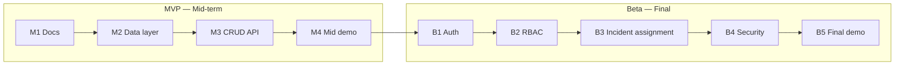

# Product Requirements Document (PRD) — DevPulse

| Field | Value |
|---|---|
| Product | DevPulse |
| Version | MVP + Beta |
| Releases | MVP — Mid-term, Beta — Final |
| Status | Draft |
| Related docs | [Software Requirements Specification (SRS)](02-srs.md), [Technical Design Document (TDD)](03-tdd.md) |

This document covers **both releases**. Every goal, feature and story has a **Release** column so it is clear what is built for the mid-term and what is added for the final.

**Documents in this set**

| Short form | Full form | Purpose | File |
|---|---|---|---|
| PRD | Product Requirements Document | What we build and why (this document) | [01-prd.md](01-prd.md) |
| SRS | Software Requirements Specification | Exact requirements, permissions and acceptance criteria | [02-srs.md](02-srs.md) |
| TDD | Technical Design Document | How we build it: architecture, data model, API | [03-tdd.md](03-tdd.md) |

## 0. Release plan

| Release | When | Focus |
|---|---|---|
| **MVP** | Mid-term | Core product: incident CRUD REST API, database, deployed on Vercel |
| **Beta** | Final | Users and permissions (auth + RBAC), incident assignment, security hardening |

## 1. Purpose

DevPulse is an internal operational incident and release management portal. Engineering teams need a clean, structured place to report outages, log bugs, and coordinate fixes. DevPulse provides a dashboard where software engineers, lead engineers, and admins can track and resolve issues efficiently in two clear steps:

1. MVP (mid-term): a small, working REST API for creating, reading, updating and deleting incidents (CRUD), deployed on Vercel.

2. Beta (final): turn the MVP into a multi-user product: accounts and login, role-based access control (RBAC), incident assignment, and security hardening.

## 2. Problem statement

Engineering teams struggle to track outages and bugs when communication is scattered across chats and emails. They need a centralized, reliable system to log incidents, assign them to the right engineers, track their resolution status, and ensure that only authorized personnel can delete or reassign critical tickets.

## 3. Goals

| ID | Goal | Release |
|---|---|---|
| G-1 | Provide a REST API for task CRUD that follows standard REST conventions. | MVP |
| G-2 | Store tasks in a database so data survives restarts and redeploys. | MVP |
| G-3 | Document the API automatically (OpenAPI at `/api/docs`). | MVP |
| G-4 | Deploy automatically to Vercel on every push to `main`. | MVP |
| G-5 | Each user has an account and sees only their own personal tasks. | Beta |
| G-6 | Control access with roles: Software Engineer, Lead Engineer, and Administrator. | Beta |
| G-7 | Let lead engineers and admins assign incidents to specific software engineers. | Beta |
| G-8 | Protect accounts and data (hashed passwords, token security, login limits). | Beta |

## 4. Target users

| User | Need | Release |
|---|---|---|
| Software Engineer | Log operational incidents, view assigned bugs, update incident statuses. | MVP/Beta |
| Lead Engineer | Triage issues, set priorities, assign incidents to team members. | Beta |
| Administrator | Manage user accounts, assign system roles, handle global application settings. | Beta |
| Instructor / reviewer | An easy way to try the API ( /api/docs) and check the code during the mid-term viva. | MVP |

## 5. Scope

### In scope — MVP (mid-term)
- Create, list, view, update (status and details) and delete incidents
- Input validation and clear error responses using Pydantic
- Health check endpoint
- Interactive API docs at /api/docs
- Automatic deploy to Vercel

### In scope — Beta (final)
- **Auth:** sign up, log in, log out, refresh session (JWT access token)
- **RBAC:** Software Engineer, Lead Engineer, and Administrator roles
- **Incident assignment:** assign incidents to specific software engineers
- **Admin management:** manage user accounts and system roles
- **Security:** hashed passwords, secure cookies, login rate limits, security headers

### Out of scope for this semester
- Automated test suite and CI/CD pipeline (GitHub Actions, branch protection) — planned for later
- Real-time WebSockets notifications
- External integrations (Slack, Jira, PagerDuty)
- Email verification and password reset workflows

## 6. Features and priority (MoSCoW)

| ID | Feature | Release | Priority |
|---|---|---|---|
| F-1 | Create incident report (Title, Description, Severity) | MVP | Must |
| F-2 | List incidents with status filtering | MVP | Must |
| F-3 | View incident details by ID | MVP | Must |
| F-4 | Update incident status and details | MVP | Must |
| F-5 | Delete incident record | MVP | Should |
| F-6 | Validation and error responses | MVP | Must |
| F-7 | Health check endpoint | MVP | Must |
| F-8 | Simple React dashboard page using the API | MVP | Could |
| F-9 | Sign up, log in, and JWT token authentication | Beta | Must |
| F-10 | Role-Based Access Control (Software Engineer, Lead, Admin) | Beta | Must |
| F-11 | Assign incident to a specific software engineer | Beta | Must |
| F-12 | Admin panel for managing user accounts and roles | Beta | Should |
| F-13 | Security hardening (password hashing, headers, session limits) | Beta | Must |

## 7. User stories

### MVP

| ID | Story | Feature |
|---|---|---|
| US-01 | As an engineer, I want to report an incident with title, description, and severity so the team knows what broke. | F-1 |
| US-02 | As an engineer, I want to list all logged incidents so I can see what is pending. | F-2 |
| US-03 | As an engineer, I want to view a single incident so I can inspect its details. | F-3 |
| US-04 | As an engineer, I want to update an incident status so my team tracks progress. | F-4 |
| US-05 | As an engineer, I want to delete an obsolete incident so the log stays clean. | F-5 |
| US-06 | As a client developer, I want clear error messages when validation fails. | F-6 |
| US-07 | As a maintainer, I want a health endpoint to verify the deployment. | F-7 |

### Beta

| ID | Story | Feature |
|---|---|---|
| US-08 | As a user, I want to sign up and log in securely using JWT tokens. | F-9 |
| US-09 | As an engineer, I want my permissions restricted based on my role. | F-10 |
| US-10 | As a lead engineer, I want to assign an incident to a specific team member. | F-11 |
| US-11 | As an admin, I want to manage user accounts and assign roles. | F-12 |
| US-12 | As a user, I want my password hashed and session protected. | F-13 |

## 8. Success metrics

### MVP
- All core CRUD REST endpoints work on the production Vercel URL.
- Data persists across redeploys via Supabase PostgreSQL.
- /api/docs correctly renders OpenAPI documentation.

### Beta
- RBAC permission matrix is strictly enforced across all endpoints.
- Unauthenticated or unauthorized users cannot modify or assign tickets.
- Passwords are securely hashed in the database

## 9. Assumptions and constraints

- Hosted on Vercel (frontend and FastAPI backend in one project, configured via `vercel.json`).
- Vercel functions are serverless, so application data must persist in an external database (Supabase PostgreSQL) rather than local file storage.
- Backend built with Python 3.10+ and FastAPI; frontend built with Vite, React, and TypeScript.
- The initial Administrator role is promoted manually in the Supabase table editor; subsequent user roles are managed via the API.
- MVP data serves as initial demo data and is not required to persist when Beta introduces user ownership and RBAC.

## 10. Milestones

### MVP — Mid-term

| Milestone | Deliverable |
|---|---|
| M1 — Docs | [PRD](01-prd.md), [SRS](02-srs.md), and [TDD](03-tdd.md) (covering MVP and Beta) approved |
| M2 — Data layer | Incident model and Supabase PostgreSQL database connection |
| M3 — API | Core CRUD REST endpoints with request/response validation |
| M4 — Mid demo | Live on Vercel, tagged `v0.1.0` (MVP) |

### Beta — Final

| Milestone | Deliverable |
|---|---|
| B1 — Auth | JWT sign up, login, logout, and profile management (password hashing, secure token storage) |
| B2 — RBAC | Role enforcement (Software Engineer, Lead Engineer, Administrator) and endpoint permission checks |
| B3 — Incident Assignment | Incident triage, severity/priority tagging, and assignment workflows |
| B4 — Security | Password hashing, rate limiting/login attempt limits, and security headers |
| B5 — Final demo | Beta live on Vercel, tagged `v1.0.0` (Beta) |

## 11. Release dependencies

- The Beta is built on top of the MVP: the same `/api/v1/incidents` endpoints stay, but in the Beta they require authentication and enforce role-based permissions (Software Engineer, Lead Engineer, Administrator).
- Database migrations (Alembic) are introduced at the start of the Beta so the schema can safely grow from one table to five without manual SQL scripts.
