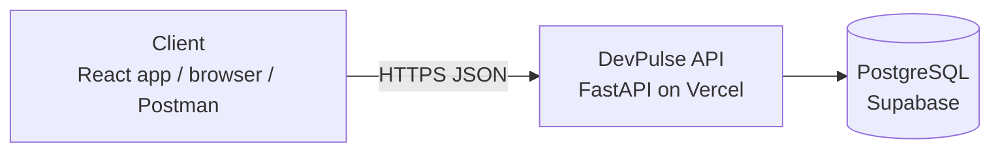
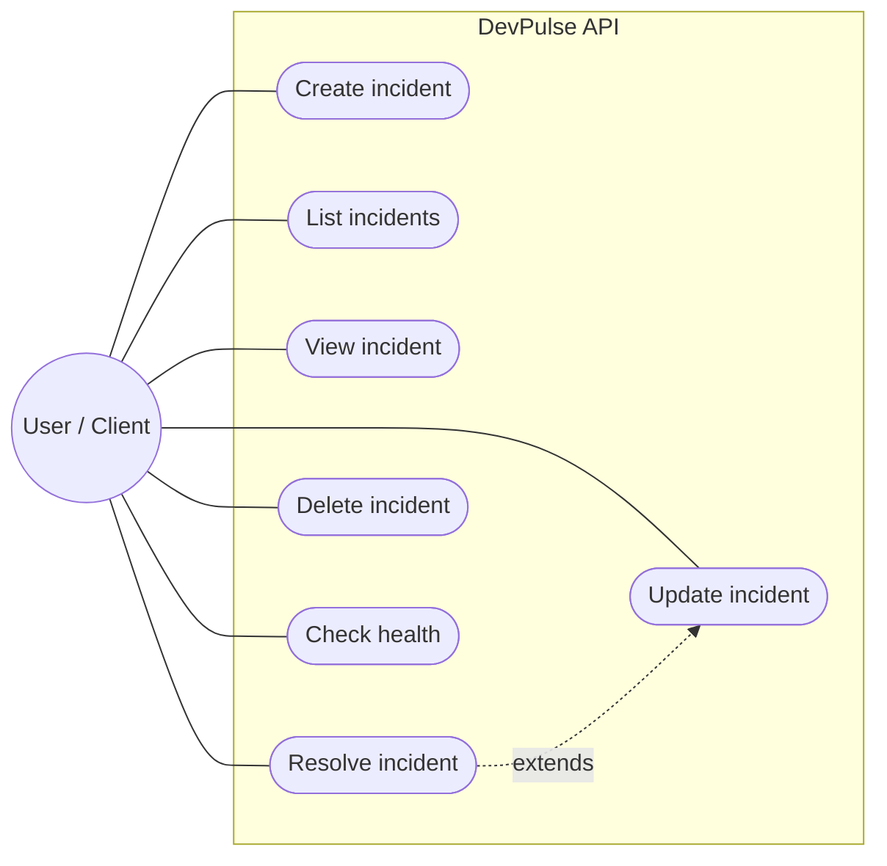
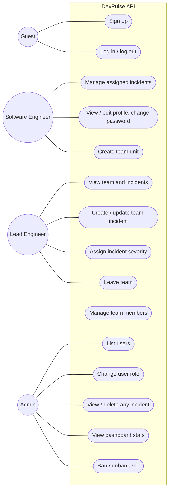
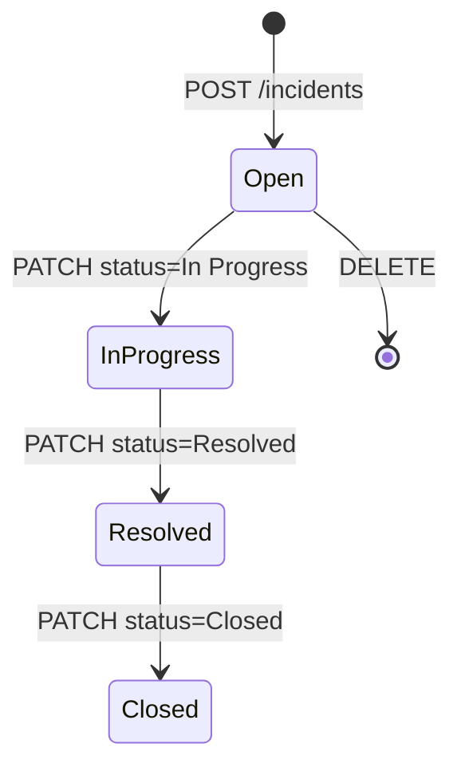

# Software Requirements Specification (SRS) — DevPulse

| Field | Value |
|---|---|
| Product | DevPulse |
| Version | MVP + Beta |
| Releases | MVP — Mid-term, Beta — Final |
| Status | Draft |
| Related docs | [Product Requirements Document (PRD)](01-prd.md), [Technical Design Document (TDD)](03-tdd.md) |

Every requirement has a **Release** column: **MVP** is built for the mid-term, **Beta** is added for the final.

**Documents in this set**

| Short form | Full form | Purpose | File |
|---|---|---|---|
| PRD | Product Requirements Document | What we build and why | [01-prd.md](01-prd.md) |
| SRS | Software Requirements Specification | Exact requirements, permissions and acceptance criteria (this document) | [02-srs.md](02-srs.md) |
| TDD | Technical Design Document | How we build it: architecture, data model, API | [03-tdd.md](03-tdd.md) |

## 1. Introduction

### 1.1 Purpose
This document lists the requirements for DevPulse: the MVP (incident CRUD REST API) and the Beta (authentication, role-based access control, team assignment, and security), deployed on Vercel.

### 1.2 Scope
- **MVP:** a client can create, list, view, update and delete incidents over HTTP. There are no accounts; all incidents are maintained in one shared system list.
- **Beta:** engineers sign up and log in, view their assigned incidents, share incident workflows through teams, and administrators manage users and roles.
- Out of scope: see [PRD, section 5](01-prd.md#5-scope).

### 1.3 Definitions

| Term | Meaning |
|---|---|
| CRUD | Create, Read, Update, Delete |
| REST | API style where resources (like `incidents`) are accessed with HTTP methods (GET, POST, PATCH, DELETE) |
| Incident | An IT or software issue report containing a title, description, severity level, status, and assignment data |
| Personal incident | (Beta) An incident assigned to or created by a specific user |
| Team | (Beta) A named engineering unit (e.g., DevOps, Core Backend) with members and a shared incident scope |
| Team incident | (Beta) An incident belonging to a team context and visible to all its members |
| RBAC | Role-Based Access Control: what a caller can execute based on their system role |
| JWT | JSON Web Token: a signed token proving the identity of the caller |
| Access token | (Beta) Short-lived JWT sent in the `Authorization: Bearer` header |
| Refresh token | (Beta) Long-lived random token stored in an HttpOnly cookie, used to acquire new access tokens |
| Client | Anything calling the API: the React frontend, `/api/docs`, curl, Postman |
| OpenAPI | Standard API description; FastAPI generates it automatically at `/api/docs` |

## 2. Overall description

### 2.1 System context

### 2.2 Users and roles

| Role | Release | Description |
|---|---|---|
| Anonymous client | MVP | Anyone reaching the API; full access to the shared incident list |
| Guest | Beta | Unauthenticated; can sign up, log in, check health status, and read API documentation |
| Software Engineer (SE) | Beta | Core contributor; reports incidents, updates working status, and views assigned tickets |
|Lead Engineer (LE) | Beta | Technical lead; handles incident triage, priority adjustments, and task delegation |
| Administrator (Admin) | Beta | System admin; dashboard metrics, user listing, role assignment, user banning, and system-wide overrides |
| Team Lead | Beta | Per-team role for the user who created the team: manages team settings and membership |
| Team Member | Beta | Per-team role: view, create, and update team-scoped incidents |

Software Engineer, Lead Engineer, and Admin are global system roles. Team leadership and membership are per-team contexts.

### 2.3 Use cases

**MVP**

**Beta**

Role permissions follow a strict hierarchy: Lead Engineers inherit all capabilities of Software Engineers, and Administrators possess full administrative and operational oversight across all system resources.

### 2.4 Constraints
- C-1: Runs on Vercel serverless functions (no local disk that survives between requests).
- C-2: Backend in Python 3.10+ with FastAPI.
- C-3: All API routes start with `/api`, because `vercel.json` sends `/api/*` to the backend.
- C-4: Requests and responses use JSON.
- C-5: Production database is Supabase PostgreSQL; local development uses SQLite.
- C-6: (Beta) Login is implemented in our own API (no third-party login providers).

### 2.5 Assumptions
- A-1: A hosted database is available to the Vercel project through an environment variable.
- A-2: The app is used for demos and class work, so traffic is low.
- A-3: (Beta) The first admin is promoted manually in the Supabase table editor.
- A-4: (Beta) MVP incidents are demo data and may be removed when incidents get an owner.
- 
## 3. Functional requirements

### 3.1 Incidents — MVP

| ID | Requirement | Release | Story |
|---|---|---|---|
| FR-01 | The system shall create an incident from a JSON payload containing title (required), description, and severity (optional). New incidents default to status = Open. | MVP | US-01 |
| FR-02 | The system shall return a paginated list of incidents ordered by recency. | MVP | US-02 |
| FR-03 | The incident list shall accept offset (default 0) and limit (default 20, max 100) query parameters. | MVP | US-02 |
| FR-04 | The system shall return a single incident matching its unique ID. | MVP | US-03 |
| FR-05 | The system shall update any combination of title, description, severity, or status on an existing incident. Omitted fields remain untouched. | MVP | US-04, US-05 |
| FR-06 | The system shall delete an incident record by ID. | MVP | US-06 |
| FR-07 | The system shall stamp created_at upon creation and update updated_at on any modification. | MVP | US-04 |
| FR-08 | The system shall reject malformed validation input with status 422 detailing failing parameters. | MVP | US-07 |
| FR-09 | The system shall return 404 when an requested incident ID does not exist. | MVP | US-07 |
| FR-10 | The system shall expose GET /api/health returning {"status": "ok"}. | MVP | US-08 |
| FR-11 | The system shall publish interactive OpenAPI documentation at /api/docs. | MVP | US-07 |

### 3.2 Authentication and profile — Beta

| ID | Requirement | Release | Story |
|---|---|---|---|
| FR-12 | The system shall permit guest registration with email, name, and password. Emails must be unique case-insensitively; duplicates trigger 409. New profiles default to Software Engineer. | Beta | US-09 |
| FR-13 | The system shall authenticate users via email and password, returning an access token in the body and setting a secure refresh token cookie. Invalid credentials return 401. | Beta | US-10 |
| FR-14 | The system shall issue a fresh access token upon valid refresh token presentation, rotating the underlying refresh token. | Beta | US-10 |
| FR-15 | The system shall terminate active sessions by revoking refresh tokens and clearing cookies. | Beta | US-10 |
| FR-16 | The system shall return the profile payload (id, email, name, role) for the active session, omitting password hashes. | Beta | US-10 |
| FR-17 | In Beta, all incident, team, and administration routes require a valid access token (401 otherwise). | Beta | US-11 |
| FR-40 | Users shall be able to update their name profile attribute. Emails and global roles cannot be modified directly via profile endpoints. | Beta | US-23, US-24 |
| FR-41 | Users shall be able to update their password by confirming current credentials. Errors return 400. Successful changes revoke all active sessions. | Beta | US-24 |

### 3.3 Incident Ownership — Beta

| ID | Requirement | Release | Story |
|---|---|---|---|
| FR-18 | Incidents managed via /api/v1/incidents link to authenticated ownership contexts. Lists return caller-accessible records. | Beta | US-11 |
| FR-19 | Accessing unauthorized incident records returns 404 to prevent resource enumeration. | Beta | US-11 |

### 3.4 RBAC and Administration — Beta

| ID | Requirement | Release | Story |
|---|---|---|---|
| FR-20 | Every registered user possesses one global system role: Software Engineer, Lead Engineer, or Administrator. | Beta | US-12 |
| FR-21 | Administrators shall be able to list registered user directories. | Beta | US-12 |
| FR-22 | Administrators shall be able to update user roles, except modifying their own role (400), ensuring administrative safety. | Beta | US-12 |
| FR-23 |Administrators shall be able to view all system incidents and purge records if required. | Beta | US-13 |
| FR-24 | Non-administrative calls to protected admin endpoints receive 403. | Beta | US-12, US-13 |
| FR-35 | Administrators shall be able to review dashboard system analytics: user counts, role distributions, ban counts, and incident volume metrics. | Beta | US-20 |
| FR-36 | Administrators shall be able to suspend accounts with audit reasons, invalidating associated refresh credentials. | Beta | US-21 |
| FR-37 | Suspended accounts receive 403 ("Account suspended") on authentication attempts. | Beta | US-21 |
| FR-38 | Administrators shall be able to lift account suspensions, restoring full access. | Beta | US-22 |
| FR-39 | User listing views shall clearly denote active and suspended account states. | Beta | US-21 |

### 3.5 Teams and Collaborative Workflows — Beta

| ID | Requirement | Release | Story |
|---|---|---|---|
| FR-25 | Users shall be able to initialize collaborative team units with custom naming parameters. | Beta | US-14 |
| FR-26 | Users shall be able to list associated team memberships. | Beta | US-14 |
| FR-27 | Team creators can update or dissolve team configurations and associated scopes. | Beta | US-14 |
| FR-28 | Team leads can provision members by email references. | Beta | US-15 |
| FR-29 | Members can disengage from teams or be unassigned by leads. | Beta | US-15, US-18 |
| FR-30 | Team members can inspect, create, and update team-scoped incident reports. | Beta | US-16 |
| FR-31 | Team incidents may include engineer assignments validated against team membership rosters (422 on mismatch). | Beta | US-17 |
| FR-32 | Team incidents can be modified by their authors or designated team leads. | Beta | US-16 |
| FR-33 | Non-members attempting team resource access receive 404. | Beta | US-16 |

### 3.6 Account security — Beta

| ID | Requirement | Release | Story |
|---|---|---|---|
| FR-34 | Exceeding 5 consecutive authentication failures blocks account entry for 15 minutes, returning 429. | Beta | US-19 |

### 3.7 Validation rules

| Field | Rule | Release |
|---|---|---|
| `title` | Required on creation, string, 1–200 characters | MVP |
| `description` | Optional, string, max 1000 characters | MVP |
| `severity` | Optional category tag (e.g., P1, P2, P3) | MVP |
| `status` | Open, In Progress, Resolved, Closed | MVP |
| `offset` | Integer ≥ 0 | MVP |
| `limit` | Integer 1–100 | MVP |
| `email` | Standard format, max 254 chars, lowercase | Beta |
| `name` (user) | 1–100 characters | Beta |
| `password` | 8–128 characters | Beta |
| `name` (group) | 1–100 characters | Beta |
| `role` | `Software Engineer, Lead Engineer, Administrator` | Beta |

### 3.8 Incident States

### 3.9 Permission matrix — Beta

| Action | Guest | Software Engineer | Lead Engineer | Administrator |
|---|---|---|---|---|
| Sign up, log in | Yes | — | — | — |
| Log out, view/edit profile | No | Yes | Yes | Yes |
| CRUD own personal incidents | No | Yes | Yes | Yes |
| Administrative user/role control (change roles, ban/unban) | No | No (`403`) | No (`403`) | Yes |
| View dashboard analytics & stats | No | No (`403`) | No (`403`) | Yes |
| Create a team | No | Yes | Yes | Yes |
| View team, members and team incidents | No | No (`404`) (Unless member) | Yes | Yes |
| Create / update / assign team incidents | No | No (`404`) (Unless member) | Yes | Yes |
| Delete a team incident | No | No | Own team incidents only | Yes |
| Rename / delete team, add / remove members | No | No (`403`) | Yes (Team Lead) | No (`403`) |
| Leave team | No | — | Yes | — |

*Note: "Software Engineer" in team contexts means a user who is not a member of that specific team.*

### 3.10 Status codes

| Case | Code | Release |
|---|---|---|
| Resource created | `201 Created` | MVP |
| Read or update succeeded | `200 OK` | MVP |
| Deleted / logged out | `204 No Content` | MVP |
| Validation failed | `422 Unprocessable Content` | MVP |
| Resource not found, or caller may not know it exists | `404 Not Found` | MVP |
| Unexpected server error | `500 Internal Server Error` | MVP |
| Bad request (e.g. admin changing own role) | `400 Bad Request` | Beta |
| Missing, invalid or expired token; wrong login | `401 Unauthorized` | Beta |
| Logged in but role not allowed, or account banned | `403 Forbidden` | Beta |
| Duplicate (email taken, already a member) | `409 Conflict` | Beta |
| Too many failed logins | `429 Too Many Requests` | Beta |

## 4. Non-functional requirements

| ID | Category | Requirement | Release |
|---|---|---|---|
| NFR-01 | Performance | 95% of task requests answer in under 500 ms (excluding a cold start). | MVP |
| NFR-02 | Persistence | Data is stored in a database and is not lost on redeploy or restart. | MVP |
| NFR-03 | Availability | The production API is reachable on the Vercel URL during the semester. | MVP |
| NFR-04 | Security | All traffic uses HTTPS (provided by Vercel). | MVP |
| NFR-05 | Security | Database credentials and secrets are stored only in Vercel environment variables, never in Git. | MVP |
| NFR-06 | Security | Database queries use the ORM with parameters, never string-built SQL. | MVP |
| NFR-07 | Security | Error responses do not expose stack traces or database details. | MVP |
| NFR-08 | Maintainability | Code is split into layers: routes, schemas, models, database. | MVP |
| NFR-09 | Usability (API) | Every endpoint is listed in `/api/docs` with request and response schemas. | MVP |
| NFR-10 | Deployability | The app runs on Vercel; a push to `main` updates production. | MVP |
| NFR-11 | Security | Passwords are hashed with Argon2; plain passwords are never stored, logged or returned. | Beta |
| NFR-12 | Security | Access tokens are JWTs signed with a secret of at least 32 bytes from an env var, valid for 15 minutes. | Beta |
| NFR-13 | Security | Refresh tokens are random, valid for 7 days, stored only as a hash, and replaced on every refresh. | Beta |
| NFR-14 | Security | The refresh token cookie is `HttpOnly`, `Secure`, `SameSite=Strict` and limited to path `/api/v1/auth`. | Beta |
| NFR-15 | Security | Frontend and API share one origin, so CORS stays disabled (no cross-origin access). | Beta |
| NFR-16 | Security | Responses include security headers: `X-Content-Type-Options`, `X-Frame-Options`, `Referrer-Policy`, `Strict-Transport-Security`. | Beta |
| NFR-17 | Security | Every permission check runs on the server for every request; the frontend hiding a button is never the only protection. | Beta |
| NFR-18 | Performance | Sign up and login answer in under 1 s (password hashing is slow on purpose). | Beta |
| NFR-19 | Maintainability | Database schema changes are made through Alembic migrations, not by hand. | Beta |

## 5. Acceptance criteria

### MVP

**AC-01 Create incident (FR-01, FR-07)**
- Given a valid body `{"title": "Database connection drop", "severity": "P1"}`
- When the client sends `POST /api/v1/incidents`
- Then the response is `201` with an `id`, `status: "Open"`, and `created_at` set.

**AC-02 Create incident with no title (FR-08)**
- Given a body `{}` or `{"title": ""}`
- When the client sends `POST /api/v1/incidents`
- Then the response is `422` and mentions `title`.

**AC-03 List incidents (FR-02, FR-03)**
- Given 25 incidents exist
- When the client sends `GET /api/v1/incidents?limit=10&offset=0`
- Then the response is `200` with 10 incidents, newest first.

**AC-04 Get incident (FR-04, FR-09)**
- Given incident `5` exists
- When the client sends `GET /api/v1/incidents/5`, the response is `200` with that incident.
- When the client sends `GET /api/v1/incidents/9999`, the response is `404`.

**AC-05 Update incident (FR-05, FR-07)**
- Given incident `5` exists with `status: "Open"`
- When the client sends `PATCH /api/v1/incidents/5` with `{"status": "In Progress"}`
- Then the response is `200`, `status` is `"In Progress"`, the title is unchanged, and `updated_at` is newer.

**AC-06 Delete incident (FR-06, FR-09)**
- Given incident `5` exists
- When the client sends `DELETE /api/v1/incidents/5`
- Then the response is `204`, and a following `GET /api/v1/incidents/5` returns `404`.

**AC-07 Health (FR-10)**
- When the client sends `GET /api/health`
- Then the response is `200` with `{"status": "ok"}`.

### Beta

**AC-08 Sign up (FR-12)**
- Given no account exists for `engineer@devpulse.io`
- When a guest signs up with that email, the response is `201` with role `Software Engineer` and no password field.
- When anyone signs up again with `Engineer@devpulse.io`, the response is `409`.

**AC-09 Log in (FR-13)**
- Given user `engineer@devpulse.io` exists
- When they log in with the right password, the response is `200` with an `access_token`, and a `refresh_token` cookie is set.
- When they log in with a wrong password, the response is `401`.

**AC-10 Token required (FR-17)**
- When a client calls `GET /api/v1/incidents` without a token, or with an expired one
- Then the response is `401`.

**AC-11 Private personal incidents (FR-18, FR-19)**
- Given user A owns incident `5`
- When user B sends `GET`, `PATCH` or `DELETE /api/v1/incidents/5`
- Then the response is `404`, and A's incident is unchanged.

**AC-12 Admin only (FR-21, FR-24)**
- When a `Software Engineer` calls `GET /api/v1/admin/users`, the response is `403`.
- When an `Administrator` calls it, the response is `200` with the user list.

**AC-13 Change role (FR-22)**
- When an admin sets user B's role to `Lead Engineer`, the response is `200` and B can now access lead endpoints.
- When an admin tries to change their own role, the response is `400`.

**AC-14 Create team (FR-25, FR-26)**
- When user A creates team "Core Backend"
- Then the response is `201`, A is the team's creator, and the team appears in A's `GET /api/v1/teams`.

**AC-15 Non-member cannot see team (FR-33)**
- Given user C is not in team `3`
- When C sends `GET /api/v1/teams/3/incidents`
- Then the response is `404`.

**AC-16 Assign team incident (FR-31)**
- Given B is a member of team `3` and C is not
- When a member assigns a team incident to B, the response is `200`.
- When a member assigns it to C, the response is `422`.

**AC-17 Login lockout (FR-34)**
- Given 5 failed logins in a row for `engineer@devpulse.io`
- When the right password is sent within 15 minutes
- Then the response is `429`; after 15 minutes the login succeeds.

**AC-18 Dashboard stats (FR-35)**
- Given 10 users (1 suspended) and 40 incidents (15 resolved)
- When an administrator sends `GET /api/v1/admin/stats`
- Then the response is `200` with the correct aggregated metrics.
- When a `Software Engineer` sends it, the response is `403`.

**AC-19 Suspend user (FR-36, FR-37)**
- Given user B is logged in with a valid access token
- When an administrator suspends B with reason "policy violation"
- Then B's next request with the same access token returns `403`, B's refresh fails, and B's login returns `403`.
- When an administrator tries to suspend themself or another administrator, the response is `400`.

**AC-20 Restore user (FR-38)**
- Given user B is suspended
- When an administrator restores B
- Then B can log in again and still sees their old incidents.

**AC-21 Edit profile (FR-40)**
- When a user sends `PATCH /api/v1/users/me` with `{"name": "Kumkum F."}`
- Then the response is `200` with the new name, and `email` and `role` are unchanged.

**AC-22 Change password (FR-41)**
- When a user sends the wrong `current_password`, the response is `400`.
- When they send the right one and a valid `new_password`, the response is `204`, their refresh fails, and they can log in only with the new password.

---

## 6. Traceability

| Story | Requirements | Endpoint (see [TDD, section 6](03-tdd.md#6-rest-api-design)) | Release |
|---|---|---|---|
| US-01 | FR-01, FR-07 | `POST /api/v1/incidents` | MVP |
| US-02 | FR-02, FR-03 | `GET /api/v1/incidents` | MVP |
| US-03 | FR-04 | `GET /api/v1/incidents/{id}` | MVP |
| US-04, US-05 | FR-05, FR-07 | `PATCH /api/v1/incidents/{id}` | MVP |
| US-06 | FR-06 | `DELETE /api/v1/incidents/{id}` | MVP |
| US-07 | FR-08, FR-09, FR-11 | All, `/api/docs` | MVP |
| US-08 | FR-10 | `GET /api/health` | MVP |
| US-09 | FR-12 | `POST /api/v1/auth/signup` | Beta |
| US-10 | FR-13 – FR-16 | `/api/v1/auth/login`, `/refresh`, `/logout`, `GET /api/v1/users/me` | Beta |
| US-11 | FR-17 – FR-19 | `/api/v1/incidents` (all) | Beta |
| US-12 | FR-20 – FR-22, FR-24 | `GET /api/v1/admin/users`, `PATCH /api/v1/admin/users/{id}/role` | Beta |
| US-13 | FR-23, FR-24 | `GET /api/v1/admin/incidents`, `DELETE /api/v1/admin/incidents/{id}` | Beta |
| US-14 | FR-25 – FR-27 | `/api/v1/teams`, `/api/v1/teams/{id}` | Beta |
| US-15 | FR-28, FR-29 | `/api/v1/teams/{id}/members` | Beta |
| US-16 | FR-30, FR-32, FR-33 | `/api/v1/teams/{id}/incidents` | Beta |
| US-17 | FR-31 | `PATCH /api/v1/teams/{id}/incidents/{incident_id}` | Beta |
| US-18 | FR-29 | `DELETE /api/v1/teams/{id}/members/{user_id}` | Beta |
| US-19 | FR-34, NFR-11 – NFR-14 | `POST /api/v1/auth/login` | Beta |
| US-20 | FR-35 | `GET /api/v1/admin/stats` | Beta |
| US-21 | FR-36, FR-37, FR-39 | `POST /api/v1/admin/users/{id}/suspend`, `GET /api/v1/admin/users` | Beta |
| US-22 | FR-38 | `POST /api/v1/admin/users/{id}/restore` | Beta |
| US-23, US-24 | FR-16, FR-40, FR-41 | `GET` / `PATCH /api/v1/users/me`, `POST /api/v1/users/me/password` | Beta |
