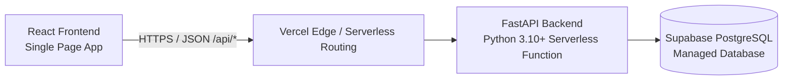
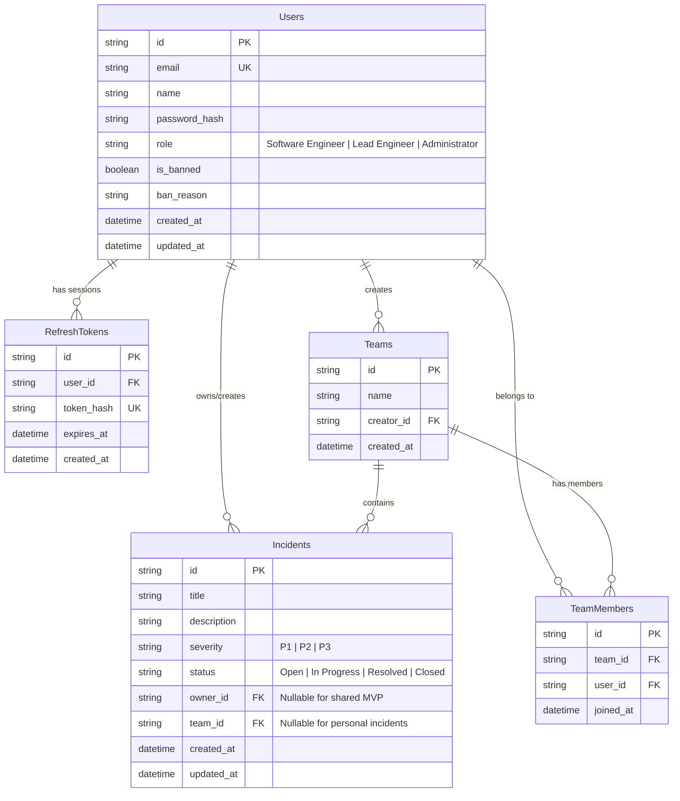

# Technical Design Document (TDD) — DevPulse

| Field | Value |
|---|---|
| Product | DevPulse |
| Version | MVP + Beta |
| Status | Final Draft |
| Related docs | [Product Requirements Document (PRD)](01-prd.md), [Software Requirements Specification (SRS)](02-srs.md) |

---

## 1. Introduction and architecture overview

### 1.1 Purpose
This document specifies the technical design, architectural patterns, data models, security implementations, and REST API route structure for **DevPulse**, an incident management and collaborative tracking system built for academic and production standards.

### 1.2 High-level architecture
DevPulse is built as a serverless full-stack web application. The frontend is a single-page application built in React (TypeScript) communicating via JSON REST endpoints with a backend built in Python (FastAPI). The entire system is hosted on Vercel.


### 2. Technology stack

| Layer | Technology | Purpose |
|---|---|---|
| Frontend | React, TypeScript, Tailwind CSS | Single-page application UI, client-side routing, incident dashboards |
| Backend Framework | FastAPI (Python 3.10+) | High-performance asynchronous API framework, automatic OpenAPI generation |
| Database & ORM | PostgreSQL (Supabase), SQLAlchemy 2.0 | Relational data persistence, schema modeling, query execution |
| Migrations | Alembic | Database schema evolution and version tracking |
| Authentication | Passlib (Argon2), PyJWT, HttpOnly Cookies | Password hashing, stateless access tokens, secure session cookie management |
| Hosting & CI/CD | Vercel | Serverless deployment, automated Git integration via `main` branch pushes |


### 3.1 Entity-relationship diagram



### 3.2 Database tables and column definitions

#### `users`
* `id`: UUID (Primary Key)
* `email`: String(254) (Unique, Case-insensitive, Index)
* `name`: String(100) (Not Null)
* `password_hash`: String(255) (Not Null)
* `role`: String(30) (Default: `Software Engineer`)
* `is_banned`: Boolean (Default: `false`)
* `ban_reason`: String(500) (Nullable)
* `created_at`: DateTime (Default: `now()`)
* `updated_at`: DateTime (Default: `now()`, On Update: `now()`)

#### `refresh_tokens`
* `id`: UUID (Primary Key)
* `user_id`: UUID (Foreign Key references `users.id`, Cascade Delete)
* `token_hash`: String(64) (Unique, SHA-256 hash of random token)
* `expires_at`: DateTime (Not Null)
* `created_at`: DateTime (Default: `now()`)

#### `incidents`
* `id`: UUID (Primary Key)
* `title`: String(200) (Not Null)
* `description`: Text (Nullable)
* `severity`: String(10) (Default: `P2`)
* `status`: String(20) (Default: `Open`)
* `owner_id`: UUID (Foreign Key references `users.id`, Nullable)
* `team_id`: UUID (Foreign Key references `teams.id`, Nullable, Cascade Delete)
* `created_at`: DateTime (Default: `now()`)
* `updated_at`: DateTime (Default: `now()`, On Update: `now()`)

#### `teams`
* `id`: UUID (Primary Key)
* `name`: String(100) (Not Null)
* `creator_id`: UUID (Foreign Key references `users.id`)
* `created_at`: DateTime (Default: `now()`)

#### `team_members`
* `id`: UUID (Primary Key)
* `team_id`: UUID (Foreign Key references `teams.id`, Cascade Delete)
* `user_id`: UUID (Foreign Key references `users.id`, Cascade Delete)
* `joined_at`: DateTime (Default: `now()`)

---

## 4. Security architecture

## 4. Security architecture

### 4.1 Authentication flow (Beta)
* **Sign Up (`POST /api/v1/auth/signup`)**: Client sends email, name, and password. Backend hashes the password using **Argon2**, creates the user with default role `Software Engineer`, and returns a `201 Created` payload.
* **Login (`POST /api/v1/auth/login`)**: Validates credentials. Enforces brute-force lockout (5 consecutive failures block IP/email for 15 minutes, returning `429`). On success, issues a 15-minute JWT `access_token` in the response body and sets a 7-day cryptographic random `refresh_token` inside an `HttpOnly`, `Secure`, `SameSite=Strict` cookie restricted to `/api/v1/auth`.
* **Token Refresh (`POST /api/v1/auth/refresh`)**: Validates the refresh token cookie, rotates the token hash in the database, and returns a fresh access token.
* **Logout (`POST /api/v1/auth/logout`)**: Revokes the refresh token record from database storage and clears the browser cookie.

### 4.2 Role-Based Access Control (RBAC) middleware
Global roles are evaluated via FastAPI dependency injectors (`get_current_user`, `require_admin`).

* **Software Engineer (SE)**: Can manage personal incidents, create teams, and interact with assigned scopes.
* **Lead Engineer (LE)**: Inherits SE privileges, handles team triage, priority adjustments, and task delegations.
* **Administrator (Admin)**: Bypasses team restrictions for audits, accesses dashboard aggregated analytics (`GET /api/v1/admin/stats`), modifies user roles, and suspends/restores accounts.

## 5. Directory structure

```text
devpulse/
├── api/                    # Vercel serverless entry point adapter
│   └── index.py            # FastAPI ASGI mount wrapper
├── src/
│   ├── main.py             # FastAPI application initialization & routing
│   ├── config.py           # Environment and settings configuration (Pydantic BaseSettings)
│   ├── database.py         # SQLAlchemy engine setup and session factory
│   ├── models/             # SQLAlchemy ORM database models
│   │   ├── user.py
│   │   ├── token.py
│   │   ├── incident.py
│   │   └── team.py
│   ├── schemas/            # Pydantic request/response validation schemas
│   │   ├── auth.py
│   │   ├── incident.py
│   │   ├── user.py
│   │   └── team.py
│   ├── routers/            # API endpoint routing logic grouped by domain
│   │   ├── auth.py
│   │   ├── incidents.py
│   │   ├── teams.py
│   │   └── admin.py
│   └── dependencies/       # Reusable FastAPI security & database dependencies
│       └── auth.py
├── alembic/                # Database migration scripts
│   ├── versions/
│   └── env.py
├── docs/                   # Project documentation (PRD, SRS, TDD)
│   ├── 01-prd.md
│   ├── 02-srs.md
│   └── 03-tdd.md
├── tests/                  # Automated pytest test suites
├── vercel.json             # Vercel deployment and routing rules
├── requirements.txt        # Python package dependencies
└── README.md
```

## 6. REST API design

### 6.1 System & Health Endpoints
* `GET /api/health` — Returns system health status (`200 OK`).
* `GET /api/docs` — Serves interactive OpenAPI Swagger documentation.

### 6.2 Authentication Endpoints (Beta)
* `POST /api/v1/auth/signup` — Register a new user profile (`201 Created`).
* `POST /api/v1/auth/login` — Authenticate credentials, return access token, set refresh cookie (`200 OK`).
* `POST /api/v1/auth/refresh` — Issue rotated access tokens via cookie presentation (`200 OK`).
* `POST /api/v1/auth/logout` — Terminate active session and clear cookie (`204 No Content`).

### 6.3 User Profile Endpoints (Beta)
* `GET /api/v1/users/me` — Retrieve active session user profile (`200 OK`).
* `PATCH /api/v1/users/me` — Update display name (`200 OK`).
* `POST /api/v1/users/me/password` — Update password and revoke other sessions (`204 No Content`).

### 6.4 Incident Endpoints (MVP & Beta)
* `GET /api/v1/incidents` — List paginated incidents (`limit`, `offset`) (`200 OK`).
* `POST /api/v1/incidents` — Create a new incident (`201 Created`).
* `GET /api/v1/incidents/{id}` — Retrieve a single incident by ID (`200 OK` or `404 Not Found`).
* `PATCH /api/v1/incidents/{id}` — Update an existing incident (`200 OK`).
* `DELETE /api/v1/incidents/{id}` — Remove an incident record (`204 No Content`).

### 6.5 Team Endpoints (Beta)
* `POST /api/v1/teams` — Initialize a collaborative team (`201 Created`).
* `GET /api/v1/teams` — List user's team memberships (`200 OK`).
* `POST /api/v1/teams/{id}/members` — Add member to team by email (`201 Created`).
* `DELETE /api/v1/teams/{id}/members/{user_id}` — Remove member or leave team (`204 No Content`).
* `GET /api/v1/teams/{id}/incidents` — List team-scoped incidents (`200 OK`).
* `POST /api/v1/teams/{id}/incidents` — Create a team-scoped incident (`201 Created`).
* `PATCH /api/v1/teams/{id}/incidents/{incident_id}` — Update team incident or assign engineer (`200 OK`).

### 6.6 Administration Endpoints (Beta - Admin Only)
* `GET /api/v1/admin/users` — Paginated list of all system users with status flags (`200 OK`).
* `PATCH /api/v1/admin/users/{id}/role` — Elevate or modify user global roles (`200 OK`).
* `GET /api/v1/admin/stats` — Aggregate system metrics and analytics (`200 OK`).
* `POST /api/v1/admin/users/{id}/suspend` — Suspend a user account with audit reasons (`200 OK`).
* `POST /api/v1/admin/users/{id}/restore` — Restore a suspended user account (`200 OK`).
* `GET /api/v1/admin/incidents` — Global oversight listing of all system incidents (`200 OK`).
* `DELETE /api/v1/admin/incidents/{id}` — System-level purge of an incident record (`204 No Content`).
